# Engineering CAD & EDA Workbench

A native Debian 13 toolchain for **ChatGPT / Codex Cloud engineering tasks**: create editable circuits and PCBs, model mechanical parts and enclosures, simulate electrical behavior, and return drawings, renders and project files through chat.

**[Showcase](#project-showcase-555-led-fader) · [Example prompts](#example-prompts-by-workflow) · [Run the tools](#use-an-installed-environment) · [Setup](#installation-and-cloud-publication) · [Validation](#verified-behavior)**

## Project showcase: 555 LED fader

An existing six-LED timer project demonstrates how the tools work together: a KiCad schematic and routed PCB, ngspice waveforms, a fitted FreeCAD enclosure, and assembly renders.

<table>
<tr>
<td width="50%"><a href="docs/showcase/555-assembly.jpg">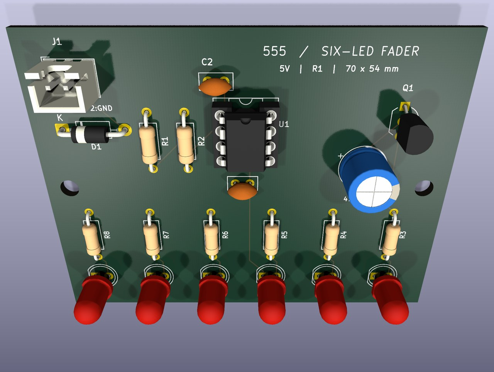</a></td>
<td width="50%"><a href="docs/showcase/555-exploded.jpg">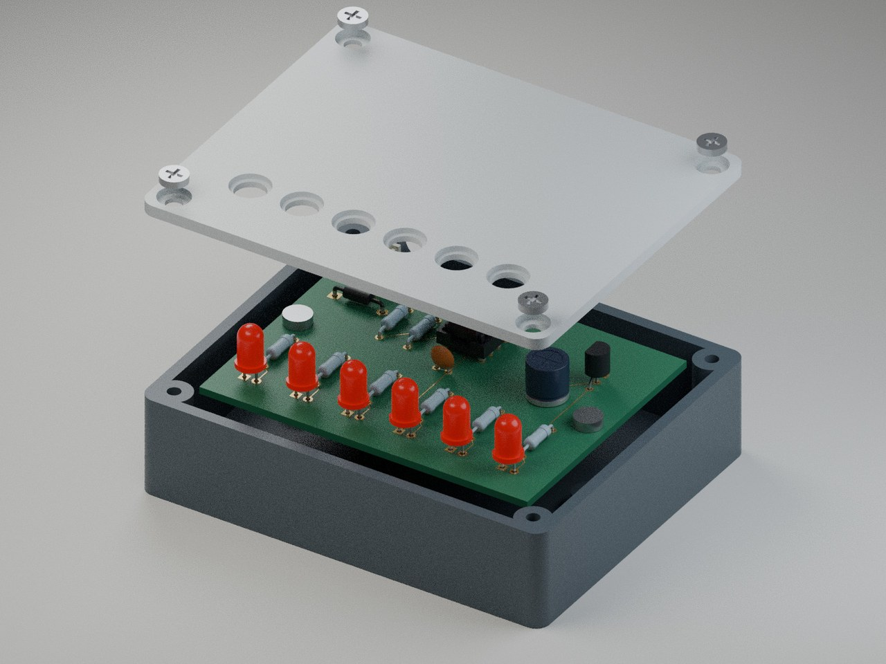</a></td>
</tr>
<tr><td><b>Electronic assembly</b><br>5 V supply, NE555 timer, transistor driver and six LEDs on a 70 × 54 mm PCB.</td><td><b>Mechanical integration</b><br>86 × 70 × 23 mm enclosure with PCB standoffs, a screw-fastened lid and aligned LED openings.</td></tr>
</table>

These images come from the owner's earlier **555 LED Fader Design Files** and **555 LED Fader Enclosure** projects. The design was reconstructed from photographs; circuit values and dimensions include assumptions. Prior project checks reported zero KiCad ERC/DRC errors and zero PCB/enclosure CAD intersections. It has **not been physically tested or test-fitted**. [Image provenance and reproduction notes](docs/showcase/README.md) distinguish those existing results from the new examples below.

## Example prompts by workflow

Copy a prompt into an installed cloud environment and attach any existing design files. Specify dimensions, units, supply voltage, manufacturing constraints and preferred formats where relevant. Each workflow can be used independently.

### Schematics, PCB layout and routing

**KiCad · SKiDL · Freerouting** — editable schematics and boards, component placement, routing, electrical/design-rule checks, fabrication files and assembled STEP exports.

[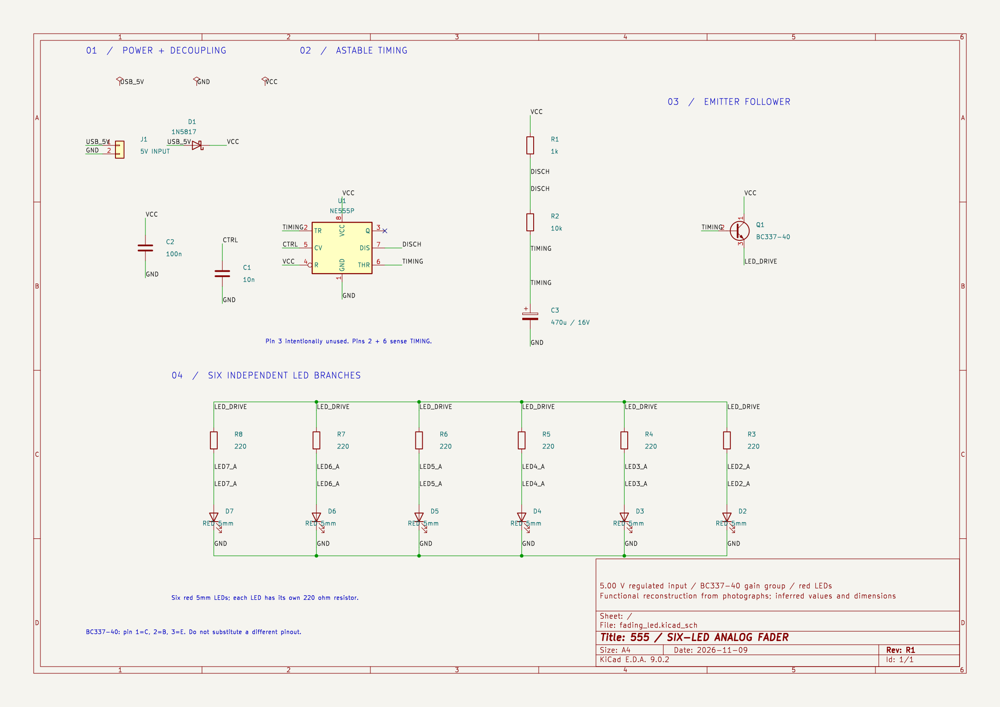](docs/showcase/555-schematic.png)

[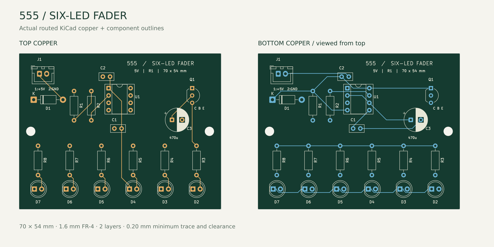](docs/showcase/555-pcb.png)

```text
Design a 5 V, six-LED fader using a 555 timer and a transistor driver.
Use a 70 × 54 mm two-layer PCB with through-hole components. Draw a clean
schematic with readable labels and no overlapping symbols. Explain the
component choices and assumptions, route the board, and run ERC, DRC and
schematic/PCB net checks. Return the editable KiCad project, Gerbers, drill
files, BOM, assembled STEP, preview images and a validation report in a ZIP.
```

For an existing board, ask to preserve its outline, connectors and design rules. Freerouting supplies a DSN → SES routing workflow; imported routes must still pass KiCad checks. [EDA workflow](docs/eda.md)

### Fritzing projects and custom components

**Fritzing · Python layout generator** — self-contained `.fzz` projects, `.fzpz` custom parts, schematic/breadboard/PCB views, native renders and Gerber/drill export.

[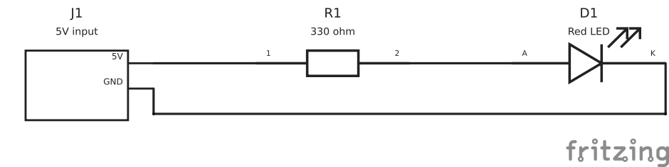](examples/fritzing/verified/schematic.png)

<table>
<tr>
<td width="50%"><a href="examples/fritzing/verified/breadboard.png">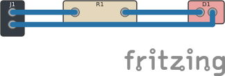</a></td>
<td width="50%"><a href="examples/fritzing/verified/pcb.png">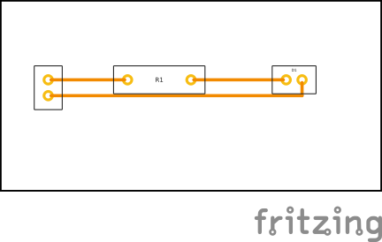</a></td>
</tr>
<tr><td>Breadboard view</td><td>Routed PCB view</td></tr>
</table>

```text
Create a Fritzing project for a 5 V connector, a 330 ohm resistor and a red
LED. Use through-hole parts and a single copper layer. Generate any custom
parts with explicit pin mappings. Keep symbols and labels clear, route
around obstacles, and check overlaps, route clearances and connectivity.
Return the design JSON, editable FZZ, FZPZ parts, PNG/SVG previews of all
three views, Gerber/drill files and the validation report.
```

Try the checked-in [editable project](examples/fritzing/verified/led-series.fzz) or [complete example bundle](examples/fritzing/verified/led-series.zip). The generator supports a documented through-hole, single-layer subset. Its layout checks are **not native Fritzing DRC or electrical ERC**; a schematic-style breadboard view is not a verified physical breadboard assembly. [Fritzing workflow and limits](docs/fritzing.md)

### Parametric parts and PCB enclosures

**FreeCAD · CadQuery · build123d · OpenSCAD** — constrained sketches, editable parameters, solid modeling, STEP/STL export and geometry checks.

<table>
<tr>
<td width="50%"><a href="docs/showcase/mechanical.png">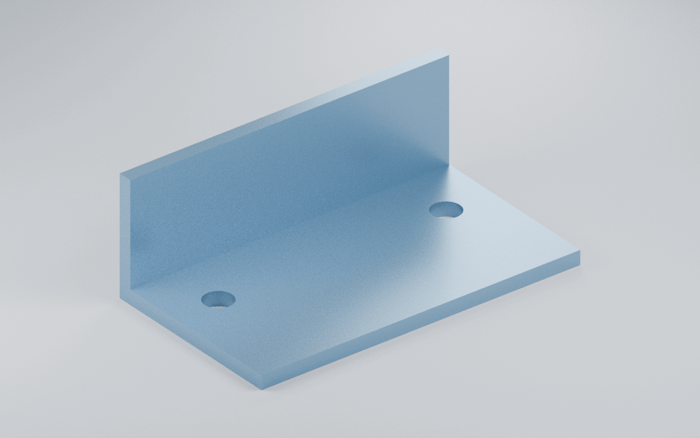</a></td>
<td width="50%"><a href="docs/showcase/555-enclosure.jpg">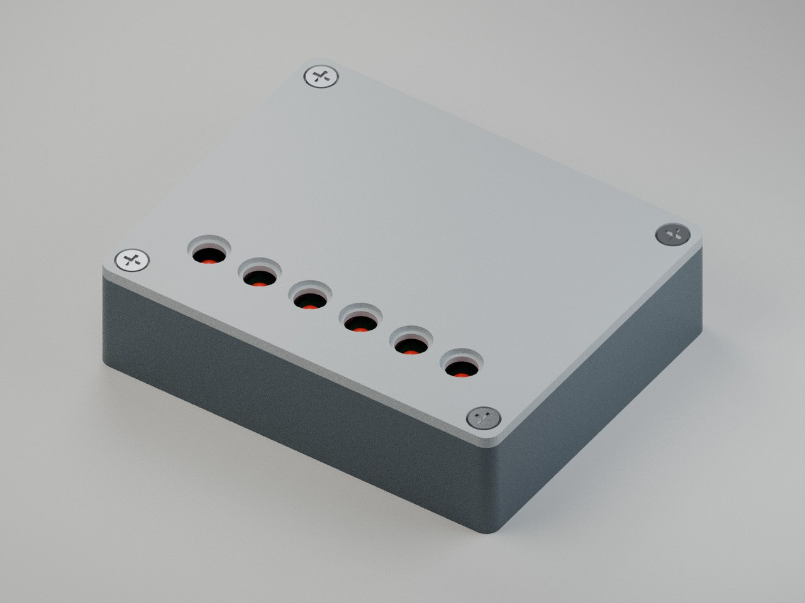</a></td>
</tr>
<tr><td><b>Parametric bracket</b><br>70 × 40 × 25 mm; three fully constrained sketches, one valid solid and checked export roundtrips.</td><td><b>PCB enclosure</b><br>2.4 mm walls, floor and lid; six recessed LED openings and internal mounting features.</td></tr>
</table>

```text
Create a parametric L-bracket in FreeCAD: 70 mm wide, 40 mm deep, 25 mm
high, with a 3 mm base and flange. Add two 6 mm mounting holes at (10, 15)
and (60, 15) mm, measured from the outer rear-left base corner, with the
flange along the rear edge. Fully constrain the sketches and expose the
main dimensions. Check solid validity, dimensions
and export roundtrips. Return FCStd, STEP, STL, the generator and a render.
```

```text
Design a screw-lid enclosure around the attached PCB STEP and mounting-hole
coordinates. Use 2.4 mm walls, 1 mm nominal clearance to the component
and board envelope, PCB standoffs, and openings aligned with the LEDs and
connector. State print-fit allowances separately. Check interference and
access, then return parametric FCStd, STEP, print-oriented watertight STLs,
a dimensioned drawing, assembled/exploded renders and the check results.
```

For code-first CAD, request a parameterized CadQuery/build123d Python file or an OpenSCAD `.scad` file. Preserve that source alongside STEP/STL. [Mechanical workflow](docs/freecad.md)

### Dimensioned technical drawings

**FreeCAD TechDraw** — drawings linked to native geometry, with PDF and SVG exports.

[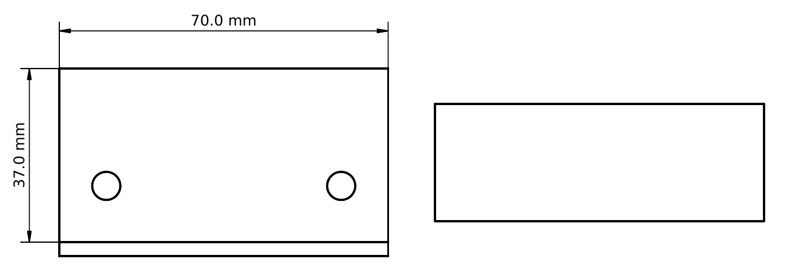](docs/showcase/technical-drawing.png)

This drawing was exported from the acceptance fixture: 70 mm overall width and 37 mm exposed base depth. Its dimension references and exported text were checked against the model.

```text
Make a dimensioned A4 drawing from the attached FreeCAD part. Include front,
top and isometric views, overall dimensions, hole diameters and hole-center
distances. Use millimetres and a stated scale. Keep dimensions linked to
the model, check every displayed value and inspect for clipping or overlaps.
Return the FCStd with its TechDraw page, a PDF and an SVG.
```

### Circuit simulation and numerical checks

**ngspice · NumPy · SciPy · Matplotlib** — DC/transient analysis, parameter sweeps, plots and numerical comparisons.

<table>
<tr>
<td width="50%"><a href="docs/showcase/555-simulation.png">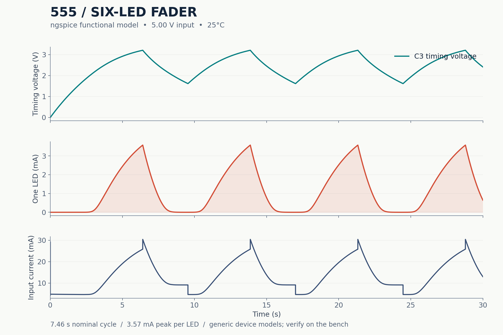</a></td>
<td width="50%"><a href="docs/showcase/simulation.png">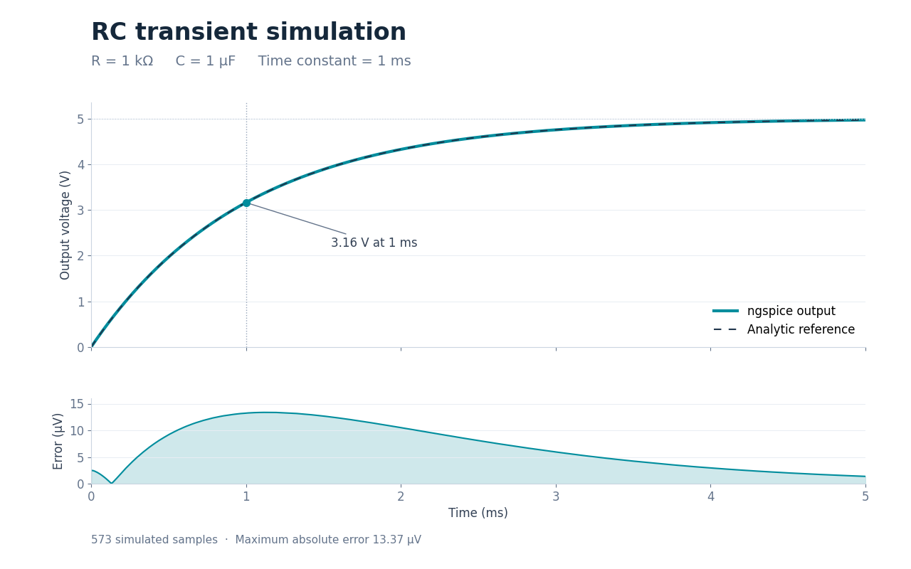</a></td>
</tr>
<tr><td><b>555 fader model</b><br>Nominal prediction: 7.46 s cycle and 3.57 mA peak per LED at 5 V and 25 °C.</td><td><b>RC reference check</b><br>573 simulated samples; maximum absolute error of 13.37 µV against the analytic response.</td></tr>
</table>

```text
Simulate the attached 555 LED-fader netlist at 4.5 V, 5 V and 5.5 V.
Sweep timing-capacitor tolerance and transistor gain. Plot timing voltage,
LED current and supply current; calculate cycle time and peak currents.
Flag stalled oscillation and explain model assumptions. Return the SPICE
netlist/models, sweep script, CSV results, plots and a concise report.
```

The 555 plots are model predictions, not measurements; its earlier low-gain stress case stalled. The RC example was rerun with native ngspice for this showcase. [Simulation and scientific Python](docs/python.md)

### Assembly rendering and short animations

**Blender · FFmpeg · ImageMagick** — CPU renders from actual CAD meshes, editable scenes, exploded views and short encoded animations. The assembly and bracket images above demonstrate the visual output.

```text
Render the attached CAD assembly with its actual geometry and units. Use
FreeCAD to tessellate STEP for Blender. Create assembled and exploded views
with clear lighting, a neutral background and all parts inside the frame.
Also make a short turntable MP4. Return the editable Blender scene, render
script, PNGs and MP4. Verify framing and the encoded video's dimensions,
frame count and duration. Preserve the original CAD files separately.
```

Still rendering and a small scripted animation/H.264 fixture are tested. This does not demonstrate physical motion solving or GPU rendering. [Rendering workflow](docs/rendering.md)

**More ideas:** [repair an existing PCB, make a parameterized OpenSCAD part, generate a tetrahedral mesh, compare design variants, or package a handoff](docs/example-prompts.md).

## Use an installed environment

```sh
cd /workspace/engineering-codex-environment
bash setup/verify.sh --quick
```

Use the existing installation for each task. Tools work independently; no fixed parts catalog, project architecture, persistent service, container or interactive desktop is required.

| Task | Entry point | Runtime |
| --- | --- | --- |
| CadQuery/build123d/OCP, scientific Python, Gmsh, SKiDL | `scripts/run-python.sh script.py` | Isolated Python 3.12 |
| FreeCAD native FCStd and solids | `scripts/run-freecad.sh script.py` | System Python 3.13 |
| FreeCAD TechDraw PDF/SVG | `scripts/run-freecad.sh --gui script.py` | Python + temporary Xvfb |
| KiCad checks/exports | `scripts/run-kicad.sh cli ...` | KiCad 9 CLI |
| Programmatic PCB creation/modification | `scripts/run-kicad.sh python script.py` | System Python + legacy pcbnew |
| Official KiCad IPC client | `scripts/run-kicad-ipc.sh script.py` | Separate client; needs live server |
| SPICE simulation | `scripts/run-ngspice.sh -b circuit.cir` | Native ngspice |
| DSN to SES autorouting | `scripts/run-freerouting.sh -de board.dsn -do board.ses` | Freerouting + Java 21 |
| Fritzing generation and routing | `python3 scripts/fritzing-project.py generate design.json --output NEW_DIRECTORY` | Standard-library Python |
| Fritzing SVG/PNG and Gerber/drill | `python3 scripts/fritzing-export.py project.fzz --output NEW_DIRECTORY --png` | Fritzing + Qt offscreen |
| Rendering | `scripts/run-blender.sh script.py ...` | Blender embedded Python |
| Constructive solid geometry | `openscad -o model.stl model.scad` | Native OpenSCAD |

Read [AGENTS.md](AGENTS.md), [toolchain](docs/toolchain.md), [independent workflows](docs/project-workflows.md), and focused [skills](skills/). Keep project source in its own repository and retain editable native files alongside neutral exports. See the [file-format guide](docs/file-formats.md).

## Verified behavior

The combined acceptance run on **2026-11-09** executed **30 commands: 12 runtime/asset probes and 18 functional acceptance commands, all passed**. A separate scientific suite ran **6 pytest tests, all passed**. Fritzing was added and validated separately on **2026-11-10**. See the [test matrix and limitations](setup/test-matrix.md), [baseline](setup/environment-report.md), and [exact versions](setup/versions.lock).

<details>
<summary>What the acceptance fixtures exercise</summary>

- FreeCAD: constrained parametric bracket, native reopen/dimension change, STEP/STL roundtrips, dimensioned TechDraw PDF/SVG.
- CadQuery/build123d/OpenSCAD: independent solid creation and validated exports. Gmsh/meshio: positive-volume tetrahedral roundtrip.
- KiCad: editable divider schematic/PCB, ERC 0, real Freerouting DSN/SES import, DRC/parity/unconnected 0, BOM/Gerber/drill and valid assembled STEP.
- ngspice: 2.5 V divider within 1e-8 V; RC transient matched analytic response within 0.01 V.
- Native grounded/fixed-joint solve: disturbance recovery and save/reopen verification. Live KiCad IPC reads actual board footprints, tracks and vias.
- Actual KiCad PCB plus FreeCAD enclosure: 23 valid solids and zero measured interference, native sources and neutral exports.
- Blender: background CPU renders, native save/reopen, nonblank pixels, camera framing and mechanical imports. FFmpeg/ImageMagick still transforms, eight-frame Blender animation and verified H.264 MP4 export.
- Fritzing: generated custom parts/projects, checked layout and routing, native rendering and fabrication export. See [its verification record](examples/fritzing/verified/verification.json).

These are checks on specific fixtures. Each new design requires its own checks.

</details>

```sh
# Full engineering acceptance, separate from inexpensive CI:
bash setup/verify.sh --full
# Fritzing independently:
bash setup/verify.sh --fritzing
# Cheap repository/CI checks (no engineering apps installed):
python3 setup/check_repository.py
```

Generated files and command evidence live under ignored `artifacts/`. Optional [mechanical](examples/mechanical-part/README.md), [electronic](examples/electronic-circuit/README.md), and [PCB/enclosure](examples/pcb-and-enclosure/README.md) fixtures explain regeneration. Bundle a project with `scripts/export-project.sh PROJECT_DIRECTORY /workspace/project.zip`.

## Installation and cloud publication

The baseline machine's major CAD applications were preinstalled; this repository adds isolated hash-locked Python packages, a checksum-locked workspace native prefix, libraries and tested wrappers. [Cloud setup](docs/cloud-environment.md) distinguishes prerequisites, installation, restoration and publication.

`bash setup/install.sh` refreshes required local dependencies without modifying project source or lockfiles; it is **not** an instruction to reinstall on every new task. Save the [cloud Install script](setup/cloud-install.sh) and [Start skill](setup/start-skill.md) in environment settings, review/save, then publish the prepared filesystem. **A commit does not publish an environment.** Fresh-task restoration remains unverified until publication and a subsequent task.

Known limits: standalone `freecadcmd --version` crashes in this distribution (the tested Python wrapper works); API 10-only IPC methods and advanced joint types remain outside validation; Blender denoising is disabled because this build lacks OpenImageDenoise. See the [matrix](setup/test-matrix.md) for optional PySpice status and other limits.
