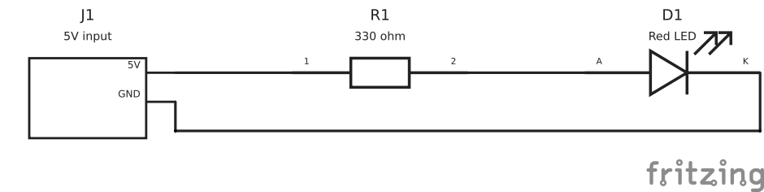
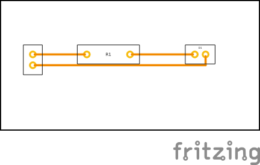

# Fritzing LED circuit acceptance example

`led-series.json` describes a 5 V input connector, 330 ohm resistor, and red LED on a 60.96 × 30.48 mm single-layer board. It is a toolchain fixture, not a verified specification for a particular LED or connector product. Check the actual component ratings, pin order, lead pitch, pad and drill dimensions before adapting it.

```sh
python3 scripts/fritzing-project.py generate examples/fritzing/led-series.json --output artifacts/my-fritzing-project
python3 scripts/fritzing-project.py validate artifacts/my-fritzing-project/project.fzz
python3 scripts/fritzing-export.py artifacts/my-fritzing-project/project.fzz --output artifacts/my-fritzing-exports --png
```

Use a new output directory for every run. Open `project.fzz` in Fritzing; it embeds the custom parts and their four SVG views. `parts/*.fzpz` imports individual reusable parts. `project.fz` is the uncompressed source sketch; use the bundled `.fzz` when sharing because the `.fz` alone does not include its custom parts. The output also preserves the design JSON, editable SVG/FZP sources, BOM, layout data, and validation report.

The generator checks component and label placement, assigned pins, actual reciprocal saved connections in all three views, pad/trace/edge clearances, and geometric net continuity. It rejects incomplete routing. These checks are limited to the workbench JSON schema; they do not replace native Fritzing DRC, an electrical review, or the fabricator's design rules. Breadboard view is a functional assembly diagram with footprint-scaled custom parts, not a solderless breadboard placement or photoreal component illustration.

See [Fritzing workflow](../../docs/fritzing.md) for schema details, installation, and current limits.

## Verified native outputs

The committed [editable FZZ](verified/led-series.fzz) and [complete output ZIP](verified/led-series.zip) were generated and opened by Fritzing 1.0.1 in offline batch mode. The ZIP contains custom parts, generator input, SVG/PNG previews, Gerber/drill, native BOM and IPC netlist, and evidence. [Verification](verified/verification.json) records 43 passing regression tests, the three matching native nets, six matching drill positions and the 60.96 × 30.48 mm Gerber contour. Native DRC and electrical ERC are not included.




